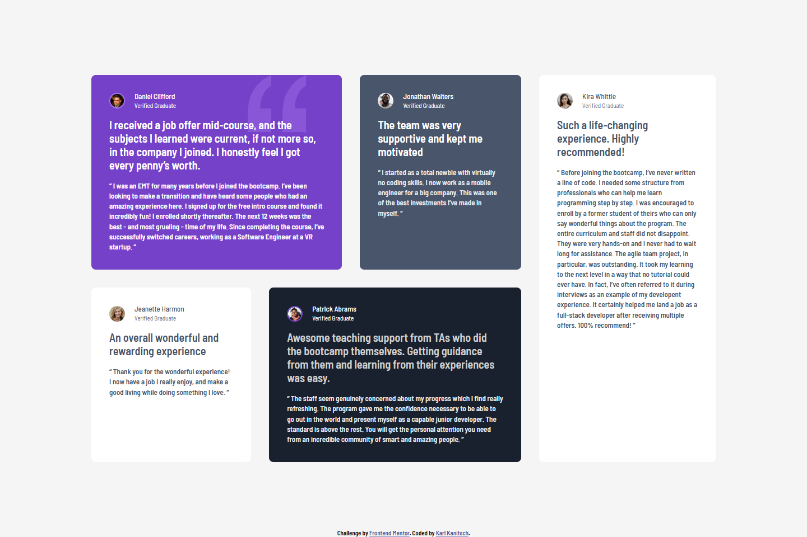
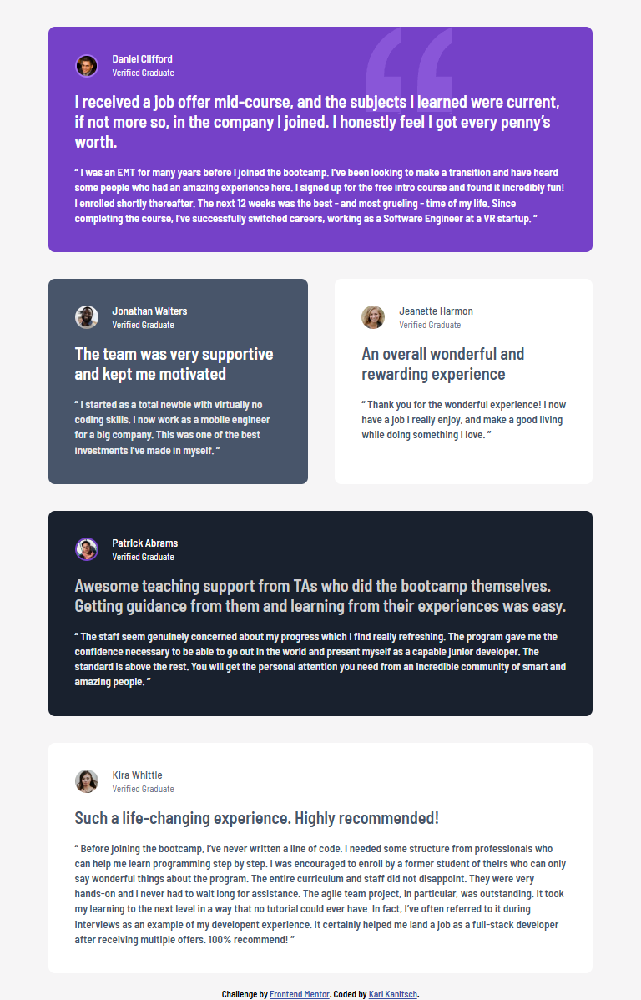

# Frontend Mentor - Testimonials grid section solution

This is a solution to the [Testimonials grid section challenge on Frontend Mentor](https://www.frontendmentor.io/challenges/testimonials-grid-section-Nnw6J7Un7). Frontend Mentor challenges help you improve your coding skills by building realistic projects. 

## Table of contents

- [Frontend Mentor - Testimonials grid section solution](#frontend-mentor---testimonials-grid-section-solution)
	- [Table of contents](#table-of-contents)
	- [Overview](#overview)
		- [The challenge](#the-challenge)
		- [Screenshot](#screenshot)
		- [Links](#links)
	- [My process](#my-process)
		- [Built with](#built-with)
		- [What I learned](#what-i-learned)
		- [Continued development](#continued-development)
		- [Useful resources](#useful-resources)
	- [Author](#author)

## Overview

This challenge was to create a simple, responsive layout of testimonial cards across three viewport widths, each with its own layout and style. I started by styling the cards while keeping the layout simple—a mobile-first workflow. Then I created two branches: one using Flexbox and the other using Grid.

I was able to complete the challenge layouts using two approaches: one with Flexbox only and one with Grid. Although I usually prefer Flexbox—even for simple 3D layouts—I found that defining simplified `grid-template-areas` made the Grid solution much easier and cleaner. This challenge still required breakpoints and `::after` pseudo-elements to accommodate the quotation-mark SVG, which appears differently in each of the three layout widths.

### The challenge

Users should be able to:

- View the optimal layout for the site depending on their device's screen size

### Screenshot

- Desktop View 
- Tablet View  
  
- Mobile View  
  

### Links

- Solution URL: [GitHub Repository](https://github.com/kkanit22/FEM-2-3-testimonials-grid-section)
- Live Site URL: [Live Site](https://kkanit22.github.io/FEM-2-3-testimonials-grid-section/)

## My process

### Built with

- Semantic HTML5 markup
- CSS custom properties
- Flexbox
- CSS Grid
- Mobile-first workflow

### What I learned

This was my first time using grid areas, so I obviously had to learn something about. I discovered a simple text grid-template-areas definition method that grid much easier to work with. For example, the following css worked for the tablet view.
```css
main {
	grid-template:
		"a a"
		"b c"
		"d d"
		"e e";
	}

	.testimonial:nth-of-type(1) {
		grid-area: a;
	}
}
```

Even better, when I set up the desktop layout I only had to define a new grid-template as the elements were already assigned to the areas.
```css
main {
	grid-template:
		"a a b e"
		"c d d e";
}
```


### Continued development

I hope to learn more about simplifying grid implementations. My biggest complaints with grid have always been the complexity of defining and assigning elements to grid sections, and the seeming inflexibility of a grid layout. I have learned how better to define grid areas, but need to learn more about less strictly defined grid flows. Hopefully then I will appreciate grid as much as I do flexbox.

### Useful resources

- [CSS Grid Template Areas In Action](https://ishadeed.com/article/grid-area/) - I found the examples and images on this site to be the best for understanding how to implement grid-template-areas and what to expect as the result.

## Author

- Frontend Mentor - [@kkanit22](https://www.frontendmentor.io/profile/kkanit22)